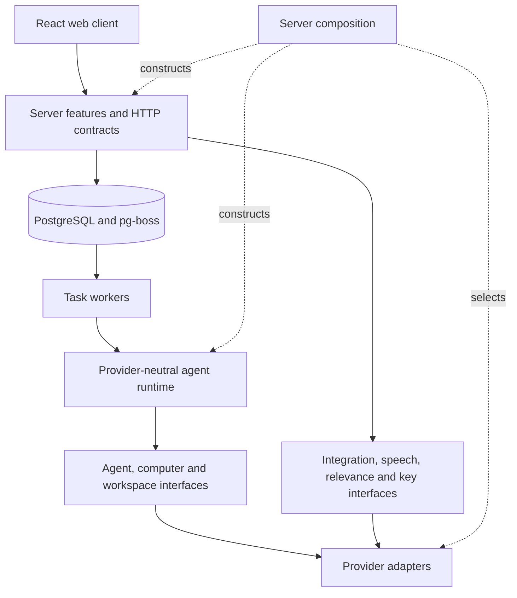

# Architecture and ownership

The web client, API, agent runtime and workers run locally in one Node process. PostgreSQL stores conversations, task revisions, goals, schedules, preferences, vault ciphertext and durable jobs. Artifact bytes, browser profiles and model transcripts live under ignored `.local/` paths.

## Dependency direction

`src/server/composition.ts` is the only application module that selects provider and runtime implementations. `src/ports` describes capabilities without vendor types. `src/providers` contains SDKs, protocol mapping and concrete execution. `src/runtime` owns tool behavior and task-segment lifecycle. `src/server` owns product policy, persistence and HTTP. `src/shared` contains browser-safe types; `src/web` imports only web/shared code.

Factories capture dependencies when constructed. There is no mutable runtime service locator. `scripts/check-architecture.mjs` rejects cross-layer imports and vendor SDKs outside adapters. See [replacement guide](replacing-modules.md) for the exact seams and state migration limits.

## Durable work

Each user request creates an independent task and durable job in the same transaction. Four workers allow unrelated requests to continue while another waits. Each task has its own transcript, workspace and browser session. PostgreSQL is authoritative; SSE carries transient text and refresh signals. Each model message has a separate stream ID, so delayed refreshes cannot clear a later message.

Credential and action-review requests end the current execution segment. The trusted form handler performs the accepted step and queues continuation. Task revisions fence late writes and old jobs. Expired credential forms can restart only their current waiting revision; older links never inject into a newer task segment. Interrupted running tasks require review after restart instead of blindly repeating external effects.

The runtime binds tools to the current task, validates their arguments, limits turns/actions, and propagates cancellation. Agent transcripts persist across segments. Computer and workspace adapters own their resource cleanup. Browser sessions close after an idle period; a later continuation may need to reopen a page and authenticate again.

## Personal context and quiet work

Profile, memories, history, goals and schedules are separate persisted records. Tools retrieve relevant context; phone numbers are not automatically included in prompts. Explicit profile/goal/schedule/memory changes proposed by the agent require review; direct UI actions are the user's instruction.

Recurring schedules use pg-boss and a saved timezone. Hourly reviews and Google events use a cheap classifier before starting a main-agent task. Preferences, active goals, recent conversation, feedback and weak engagement signals inform that check. Quiet hours and rate limits remain server policy. Background tasks suppress streamed prose and automatic final replies; they send explicit messages only for useful results or necessary questions.

## External capabilities

Composio implements Google authorization, refresh, API tools and verified event normalization. Sidekick owns connection intent, event deduplication, revocation, approval policy and notification decisions. Provider-tagged references prevent a replacement provider from reusing old credentials or event identities accidentally.

The Docker shell is offline and has no host secrets or Docker socket. Browser actions use a trusted adapter with public-web egress checks and a separate authenticated profile. The browser broker injects credentials without exposing them to the model. Neither adapter gives the agent native Mac control. Task folders share one local-owner container; production tenant isolation is a separate requirement.

The vault uses an injected key source. macOS Keychain is the local default; another host can supply the same key through the environment for testing. A hosted service should use a separate credential broker and managed key service. An operator controlling the decrypting service can access plaintext; these boundaries do not promise secrecy from that operator.

See [security](security.md), [API contract](api-contract.md) and [production requirements](production.md) before changing trust or deployment boundaries.
