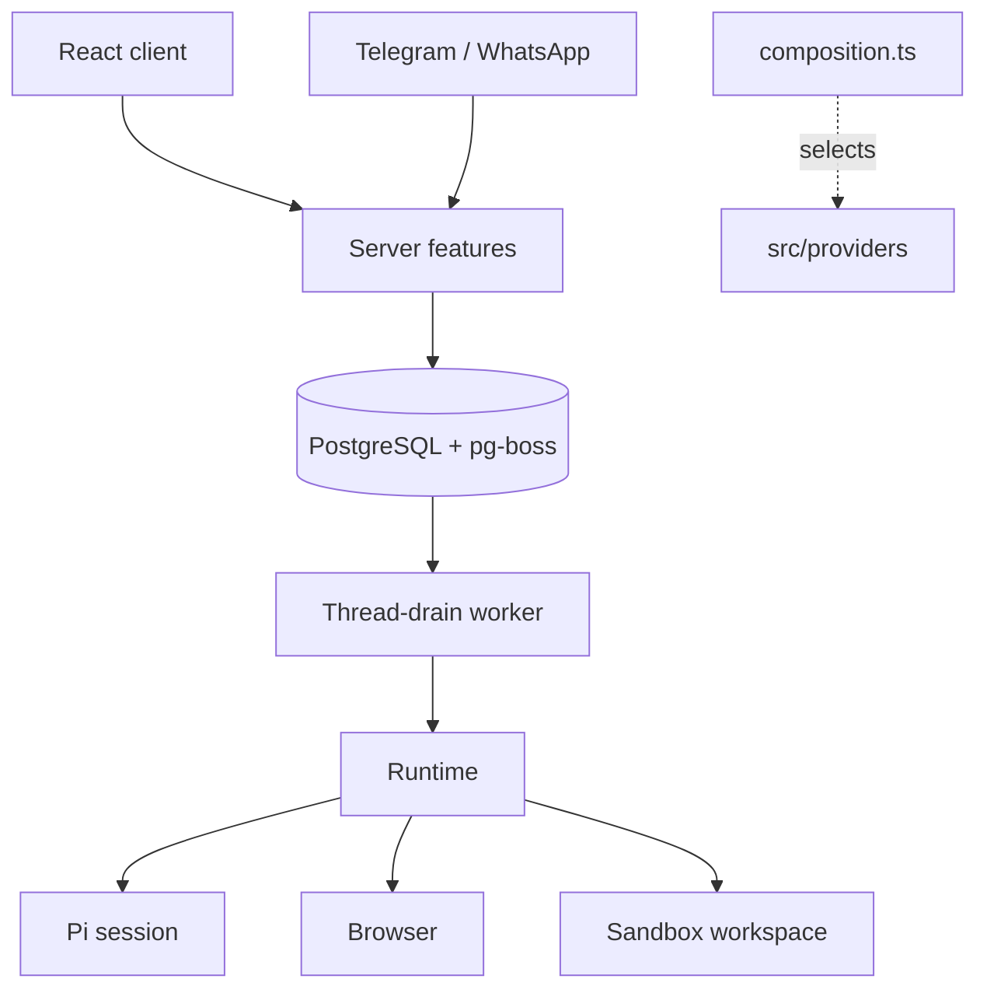

# Architecture

Local mode is one Node process (React client, Fastify API, agent runtime, thread-drain worker, schedulers) plus Docker containers for PostgreSQL, the workspace and the browser. Hosted mode runs the same feature graph once per user behind a gateway. `OTTO_MODE` selects `local`, `gateway` or `tenant`.

Code layout: `src/ports` defines capabilities without vendor types, `src/providers` holds SDKs and protocols, `src/runtime` owns tools, prompts and turns, `src/server` owns policy, persistence and HTTP, `src/shared` holds browser-safe types, and `src/web` is the client. `src/server/composition.ts` is the only place that selects implementations; `scripts/check-architecture.mjs` enforces import directions.

## Thread and turns

Each owner has one active `threads` row (`idle`, `running` or `manual_control`), shared by every channel. Its ID keys one persistent Pi session, one workspace and one browser computer.

Every user message, schedule fire, event wake, reaction and resume inserts a `turns` row (`source`: `user`, `schedule`, `event`, `resume`) and a `thread-drain` job in one transaction. The worker locks the thread and, while it is idle, claims the oldest queued turn. Turn status moves `queued` → `running` → `succeeded`, `waiting`, `failed` or `cancelled`. Each turn records its reply channel, so a Telegram message is answered on Telegram.

- `withTurnLock(turnId, op)` fences every write: the turn must be `running` on the active thread.
- A question, approval or credential request ends the turn `waiting`. The next user message is simply the next turn in the same Pi session. Completed forms, app connections and approvals queue a `resume` turn.
- Stop aborts the running turn and cancels queued ones. There is no turn timeout.
- Nothing is retried. An error or restart ends the turn `failed` with one fixed message asking the user to check outside effects or say continue.
- Reset (Get started) archives the thread and cancels its turns; the next turn starts a new Pi session, workspace and computer. Messages, accounts, Vault, goals and schedules are kept. The client's `threadId` fences late writes after a reset.
- Background turns (schedules, events) stream nothing and deliver only explicit `send_message` calls.

There is no migration from the earlier task model; existing databases must be reset.

## Runtime

`src/runtime` runs one turn at a time per thread. Pi keeps the transcript and handles compaction; recent history is sent only when Pi has no saved session. Hosted transcripts are checkpointed to object storage before each tool, at turn boundaries and before completion. A restored checkpoint over 8 MiB is rebased on load to the model-visible context (the latest compaction plus later messages). When a loaded session ends with tool calls lacking results, each call gets an "interrupted, outcome unknown" result.

Pi-native tools (read, bash, edit, write, find, ls) are built in `providers/pi/sandbox.ts` on top of `WorkspaceSession.exec`. Nothing runs on the host: bash gets an empty environment, output is written in the sandbox and only a tail reaches Pi, and no workspace file is loaded as instructions.

Otto tools: `send_message`, `ask_user`, `react_to_message`, `browser`, `sign_in`, `browser_session`, `apps`, `manage_apps`, `manage_personal_context`, `share_file`, `create_audio` and optional `web_search`. The last two run server-side because they use provider keys. Every tool call goes through one guard that checks cancellation, enforces read-only turns and records observations.

Skills in `src/runtime/skills` (careful-research, sign-in, schedules-and-watches, connected-apps) are staged into the sandbox on each session open and hold workflow guidance.

## Sandbox and browser

The workspace runs arbitrary commands as an unprivileged user with dropped capabilities and resource limits. Commands go through a supervisor that owns the process group, enforces timeouts and acknowledges completion; a lost acknowledgement fences the workspace. It never receives provider keys, the Docker socket or browser profiles. Network access follows Docker routing; there is no egress firewall.

The browser is a separate trusted container. The host drives it over a fixed stdin bridge to a private Unix socket; the workspace shares neither its mounts nor its network namespace. The model gets bounded actions (open, snapshot, click, fill, press, scroll, screenshot, download), never JavaScript, CDP, profiles or Vault reads. Manual control pauses the thread and lets the owner drive the browser; native sign-in opens the same profile without automation for the user to finish a login.

Providers: Docker locally, Cloudflare containers (separate browser and workspace roles per owner) in hosted mode, and an optional E2B combined sandbox.

## Hosted mode

The public Worker serves the web app and sends `/api/*` to a private Node gateway. The gateway authenticates Google sessions, provisions a tenant SQL role with private app and jobs schemas, and forwards signed requests to that user's tenant container. Each tenant has an immutable owner, its own process, SQL login and schemas, and a leased generation; a replacement requires confirmed stop of the previous generation. Browser and workspace containers start on first use and checkpoint to private R2 when idle. Admission defaults to eight users. Operations are in [deployment/cloudflare/README.md](../deployment/cloudflare/README.md).

## Features

**Approvals.** `action-policy.ts` lets clear ordinary requests and five reversible plan actions (goal create/update, schedule create/update/cancel) from the current owned user message run directly. Unknown, destructive or ambiguous actions persist a specific yes/no question bound to the action, account and arguments. A yes queues a `resume` turn that executes once; failure or interruption marks it uncertain and it is never re-run. Background turns and onboarding cannot grant authority.

**Vault and sign-in.** AES-GCM encrypted logins and cards, keyed outside PostgreSQL (Keychain, `OTTO_VAULT_KEY`, or a per-user derived key in hosted mode). `sign_in` inspects grouped authentication choices and semantic fields; each method follows the user's choice. Secure forms collect reusable credentials, including PINs, and the broker injects them after rechecking owner, turn, exact origin and expiry. Registered verification-code replies are intercepted before persistence. Email challenges can use an exact owned mailbox, or resolve a masked recipient against the recently selected account; the server verifies the sender, freshness and account again before entering a code once. QR and device approval require user control. Saved website sessions keep a private browser profile.

**Channels.** Telegram and WhatsApp settings are encrypted per owner. Inbound messages are saved to an inbox and become turns on the same thread; replies go through a durable outbox that rechecks owner and sender. Uncertain sends are not replayed.

**Schedules and triage.** Schedules store a one-off time or cron with timezone and queue each occurrence as a delayed pg-boss job; dispatch creates the turn and the next job atomically. A run can save one observation for comparison with later runs. Connected-app events and hourly reviews pass a cheap classifier and quiet-hours checks before waking the agent.

**Integrations.** Composio handles Google and Slack accounts; Notion and Linear use direct MCP OAuth. Discovered connections let the agent propose a public HTTPS MCP, HTTP API or installed CLI path; grants live in Vault and non-read calls go through approvals. Every write binds to an owned `connectionId`.

**Inspector and usage.** A private developer view (Screen, Activity, Tools, Models, Costs, Prompts) backed by masked, bounded records kept seven days. Gated by `DEV_INSPECTOR` and, in hosted mode, `OTTO_DEVELOPER_IDS`. Unknown prices stay null.

## Security boundaries

- Local mode binds to loopback with one fixed owner; it is not public authentication. Public hosting uses the gateway.
- Provider keys stay in the trusted server: never in prompts, the client, workspace, browser, artifacts or logs.
- Hosted: `OTTO_MASTER_KEY` stays in the gateway and derives per-user database passwords, runtime signing secrets and Vault keys. Tenants receive only their own derived values and cannot read another tenant's schema or assume its role. Public owner or account headers never select a tenant.
- Gateway-to-tenant HMAC envelopes bind owner, environment, generation, method, target, body hash, nonce, expiry and developer capability; replays and altered bodies are rejected.
- Uploads are limited to 15 MB. Artifacts are read inside the sandbox with no-follow descriptors and served from private storage; active files download as attachments.
- Prompt instructions are not a secrecy boundary. Write authority comes from the current owned user message and server checks, not model output. Prompt-injection resistance is not claimed.
- The infrastructure operator can decrypt stored data; there is no KMS or externally controlled key release.
