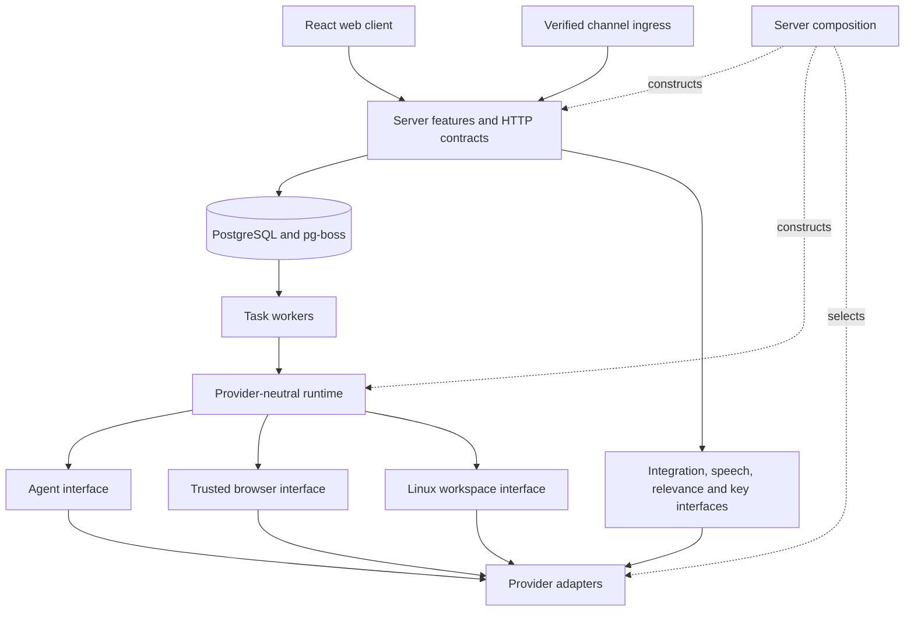

# Architecture and ownership

The local Node process serves the React client, Fastify API, agent runtime, four task workers, and schedulers. PostgreSQL stores conversations, task revisions, personal context, approval records, encrypted credentials/channel settings, and durable jobs. Files, masked browser images, profiles, and agent transcripts live under ignored `.local/` paths. Docker supplies the command-line workspace and a separate network guard.

## Code boundaries

`src/server/composition.ts` selects adapters and binds feature factories. `src/ports` defines capabilities without vendor types. `src/providers` contains SDKs, protocol mapping, and concrete execution. `src/runtime` owns tools, budgets, prompts, and task segments. `src/server` owns product policy, authorization, persistence, and HTTP. `src/shared` contains browser-safe types; `src/web` imports only web/shared code.

Factories capture dependencies rather than reading a mutable service locator. `scripts/check-architecture.mjs` checks import directions. These are code boundaries within a trusted local process, not separate operating-system identities. See [replacing modules](replacing-modules.md) for state that must migrate with a provider.

## Conversation and durable tasks

A new request creates a task and pg-boss job in the same transaction. A reply can continue the conversation's single task waiting for an ordinary question; the web app asks the user to select a task when several are waiting. Explicit task selection and starting a new task are separate choices. Secure credentials and approvals have their own continuation paths.

Tasks have separate transcripts, workspaces, and browser sessions. A server-derived channel identity prevents a Telegram answer from continuing an unrelated web or WhatsApp task. Channel inbox identity and task dispatch are durable and deduplicated.

PostgreSQL is authoritative. SSE carries transient text and refresh signals; each model message has a stream ID. Credential and approval requests end a segment and release its worker. Task revisions fence stale forms, jobs, and late writes. Cancellation stops further accepted tool work. An action already accepted by an external service may still complete.

After a restart, interrupted running tasks need review before proceeding. Approvals and channel sends with uncertain outcomes are not replayed automatically. Internal transaction deduplication cannot make a browser click or external API request exactly once.

## Personal context and background work

Bounded profile fields, saved facts, and active goal summaries enter task context as data. Phone numbers are excluded from automatic profile context. Stored facts do not grant tool permissions.

The server supplies the current owned user-message ID. Automatic learning requires a matching quote and explicit personal fact; profile fields require a recognized self-statement or an answer to the matching question. Other personal changes use review. This limited source check does not prove all user text is benign or eliminate prompt injection.

Preferences and feedback inform a cheap classifier before connected events or hourly reviews start main-agent work. Active goals permit review even with an empty notification rule. The server independently enforces quiet hours, dispatch limits, source identity, and deduplication. Default preferences favor useful, time-sensitive changes; users can change them through conversation.

Background tasks suppress streamed prose and automatic final replies. They may explicitly send a useful result or necessary question. Saved decisions can be reconsidered later; there is no guaranteed digest delivery. Schedules use pg-boss and a saved timezone while the local process is running.

## Browser and Linux workspace

The browser runs through a trusted adapter with its own public-web proxy, profile, protected fields, and credential broker. The runtime exposes bounded browser actions, not arbitrary JavaScript, CDP, profile files, or vault reads. Secure entry rechecks the origin, current form, and task revision and blocks observation during injection. The website still receives the submitted values.

The inspector stays alongside chat. It requests screenshots about once a second, hides the view during credential injection, and labels retained last-known images. Recovery never opens a URL merely to display a screenshot. A restarted session that previously handled credentials requires explicit reopening before new inspection because its secret-redaction state was in memory.

The shell runs as `node` in a Linux container with all capabilities dropped, no privilege escalation, and CPU/memory/process limits. Only task workspaces and the `workspace-tools` home volume are mounted. Provider environment variables, the Docker socket, and browser profiles are absent.

A separate `network-guard` container owns `NET_ADMIN`. The workspace shares its network namespace but cannot change its firewall. The guard permits public IPv4 and DNS, rejects private/LAN/metadata IPv4 destinations, and blocks external IPv6. CLI tools installed through npm or pipx persist under `/home/node`. Native GUI/OS applications are not implemented.

Tasks share this local-owner container and home volume. Shell commands can access other task folders in that container and send accessible data to public endpoints. The design separates shell access from the trusted browser; it does not promise hostile-code isolation between tasks or complete data-loss prevention.

## Google accounts and messaging

Composio owns OAuth refresh and vendor tool transport. Sidekick owns multiple account records, provider identity, consent attempts, revocation, watch intent, approvals, and event deduplication. Account labels come from provider responses when available.

A Google action resolves an owned local `connectionId` before execution. Proposed writes save that ID in the approval; execution checks it again and supplies the provider account explicitly. Missing, revoked, foreign, or obsolete account references cannot silently choose another account. Old approvals without an account binding require a new request.

Approval preflight rejects invalid account bindings before the action starts. An execution failure, including a provider response that contains an error without throwing, remains uncertain and cannot produce a success continuation. Public errors exclude raw provider details.

Gmail/Calendar watches are desired by default. Subscription state is separate from that preference; unavailable signed-webhook configuration is shown honestly. Verified events must match owner, account, and subscription before they reach relevance checks.

Channel setup accepts credentials only through local forms. `channel-settings.ts` encrypts them with owner/channel-bound AES-GCM; the injected key store keeps the key outside PostgreSQL. Composition creates or replaces the transport after verification. Status routes expose metadata, not secrets. Disconnect removes saved ciphertext and overrides legacy environment enablement, but does not revoke the provider token.

Telegram polling saves inbox data before advancing its durable offset. Webhooks verify raw bytes and the configured sender. Task/job creation and inbox mapping share a transaction; assistant replies enter a durable outbox with account and sender rechecks. WhatsApp applies the 24-hour reply window. Provider setup and local database commit are not atomic; uncertain webhook registration needs provider inspection.

Read [security](security.md), [API contract](api-contract.md), [channel recovery](channels.md), and [production requirements](production.md) before changing these boundaries.
