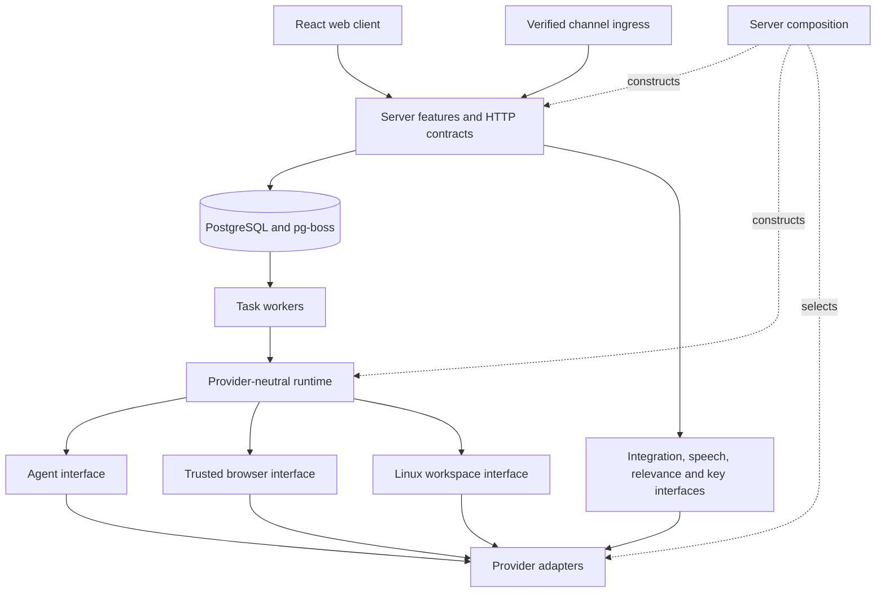

# Architecture and ownership

The local Node process serves the React client, Fastify API, agent runtime, four task workers, and schedulers. PostgreSQL stores conversations, task revisions, personal context, approval records, encrypted credentials/channel settings, and durable jobs. Task files, artifacts and agent transcripts live under ignored `.local/` paths. Docker runs PostgreSQL, the command-line workspace and a separate trusted browser. Browser profiles, masked captures and runtime state stay in the private `browser-data` volume.

## Code boundaries

`src/server/composition.ts` selects adapters and binds feature factories. `src/ports` defines capabilities without vendor types. `src/providers` contains SDKs, protocol mapping, and concrete execution. `src/runtime` owns tools, budgets, prompts, and task segments. `src/server` owns product policy, authorization, persistence, and HTTP. `src/shared` contains browser-safe types; `src/web` imports only web/shared code.

Factories capture dependencies rather than reading a mutable service locator. `scripts/check-architecture.mjs` checks import directions. Most feature boundaries are code boundaries in the trusted server. The browser and untrusted shell run in separate containers with separate mounts, processes and network namespaces. See [replacing modules](replacing-modules.md) for state that must migrate with a provider.

## Conversation and durable tasks

A new request creates a task and pg-boss job in the same transaction. One visible chat hides these internal tasks. A short answer follows the latest visible assistant question; an explicit same-channel reply selects its originating work. Idle work resumes; related messages during active work queue behind the same session. A reply to cancelled work can start a new execution retaining the quote. Secure credentials and manual control have dedicated continuation paths. Action confirmations use owned yes/no chat replies and durable worker execution.

`outcomes` records represent new concrete requests classified by an optional injected conversation router; `tasks` remain execution sessions with nullable outcome links. Greetings and small answers need no outcome. Existing rows are not backfilled. Route preparation receives bounded same-owner/current-channel candidates outside transactions, including accepted pending messages, with a shared five-second limit. It also supplies up to 12 current-generation conversation messages not already present in candidate transcripts. Explicit null outcome provenance preserves the context of ordinary preference corrections without attaching them to active work. The OpenAI default is GPT-6 Luna; `ROUTING_MODEL` can override it. Apply rechecks owner, channel, conversation generation and target state under the conversation lock. Invalid/unavailable classification falls back to an unclassified conversation execution. This is bounded semantic assistance, not guaranteed intent recognition.

`pending_task_inputs` stores related messages in order without overlapping browser runs. Safe segment completion and restart recovery drain eligible inputs. Secure/approval/manual waits retain them; cancellation/reset discard them. Each segment retains its exact source-message ID for personal learning and approvals, while synthetic resumes have no direct-user source. Later queued messages and attachments are excluded from that segment's runtime context. Outcome completion is not inferred from execution success; automatic outcome completion and a user outcome-management UI are not implemented.

Get started archives the current web generation, cancels its pending work and starts onboarding through the same UI event. Stored messages remain recoverable by a future restore path, but no restore button exists. Connections, Vault, saved personal context, goals, schedules and other channels remain intact. `conversationRevision` fences state, history, SSE, submissions and onboarding across reset; task revisions still fence individual execution segments. Archived messages cannot be reaction or reply targets and do not enter current conversation context. This reset was tested with synthetic data, not the live owner conversation.

Tasks have separate transcripts, workspaces, and browser sessions. A server-derived channel identity prevents a Telegram answer from continuing an unrelated web or WhatsApp task. Channel inbox identity and task dispatch are durable and deduplicated.

Bounded recent text from the same owner's other verified channels can inform the assistant. This shared context excludes archived web generations, action-target message IDs and provider sender/account identifiers. It does not let a cross-channel reply resume another channel's task or authorize an action.

Elapsed time does not insert chat messages. The agent sends progress only when it can name a useful finding, a meaningful delay or a required decision. The normal reply boundary preserves cancellation and revision checks. Background runs keep routine progress and completion quiet.

PostgreSQL is authoritative. SSE carries transient text and refresh signals; each model message has a stream ID. Credential and approval requests end a segment and release its worker. Task revisions fence stale forms, jobs, and late writes. Cancellation stops further accepted tool work. An action already accepted by an external service may still complete.

After a restart, interrupted running tasks need review before proceeding. Approvals and channel sends with uncertain outcomes are not replayed automatically. Internal transaction deduplication cannot make a browser click or external API request exactly once.

## Personal context and background work

Bounded profile fields, saved facts, and active goal summaries enter task context as data. An explicitly saved profile phone can enter main-agent context; provider sender identifiers never establish identity or create profile facts. Stored facts do not grant tool permissions.

The server supplies the current owned user-message ID. Automatic learning requires a matching quote and explicit personal fact; profile fields require a recognized self-statement or an answer to the matching question. Other personal changes use review. This limited source check does not prove all user text is benign or eliminate prompt injection.

Preferences and feedback inform a cheap classifier before connected events or hourly reviews start main-agent work. Active goals permit review even with an empty notification rule. The server independently enforces quiet hours, dispatch limits, source identity, and deduplication. Default preferences favor useful, time-sensitive changes; users can change them through conversation.

Background tasks suppress streamed prose and automatic final replies. They may explicitly send a useful result or necessary question. Saved decisions can be reconsidered later; there is no guaranteed digest delivery. Browser onboarding saves the detected IANA timezone. Runtime context uses that preference or the explicit Europe/Lisbon default, never the host timezone; schedule requests use the same zone unless the user chooses another. `server/schedules.ts` stores one-off times or recurring cron with the saved timezone, then queues each exact occurrence as a delayed pg-boss job. Dispatch creates the task, immutable schedule-run snapshot and next recurring job in one transaction. Job IDs and schedule revisions reject stale delivery after changes; one-off schedules disable after firing. An overdue occurrence runs once after restart, then recurring work advances to the next future occurrence without a catch-up flood. Each run also copies the saved user authorization and operational prompt. Known ordinary app actions must match both; generic events, cross-app actions and draft-only instructions cannot grant transmission. Prompt changes replace future authorization. History survives schedule deletion and derives status from the actual execution. The Mac must be awake and the local service running for dispatch; timers are not a hosted alarm guarantee.

## Browser and Linux workspace

The browser runs only inside `sidekick-browser`, using the image's `/usr/bin/chromium` and a task-specific profile. `providers/container-browser` sends a bounded, validated operation over a fixed `docker exec -i` bridge to a private Unix socket. No browser port is published, and neither the socket nor `browser-data` is mounted into the untrusted workspace. Request data travels on stdin rather than shell arguments. Cancellation waits for the remote operation to drain; an uncertain transport failure prevents further work until restart.

Each Computer permits four tracked live browser sessions before a new launch must close the oldest idle, unheld session. Protected waits, queued/running browser commands and manual/native control cannot be evicted. When all slots are protected, the new launch reports capacity instead of starting another process. Eviction keeps the profile and last-known image, but another task may need to reopen its page. This is a per-Computer launch bound, not a memory guarantee for arbitrary websites or pre-existing daemons.

The worker keeps protected fields and broker-controlled credential entry. Browser navigation accepts HTTP(S) without URL userinfo; private hosts, IPs and ports are not denied. The runtime exposes bounded browser actions, not arbitrary JavaScript, CDP, profile files, or Vault reads. Secure entry rechecks the origin, current form, and task revision and blocks observation during injection. The website still receives the submitted values. The production browser uses the container as its operating-system boundary with Chromium's internal sandbox disabled; it is not isolated from the trusted browser worker. Provider keys and the Vault master key remain outside this container.

The inspector stays alongside chat. `web/components/inspector-screen.tsx` supplies the same screenshot and manual-control view to Screen and the dedicated `/browser` window. Core browser access remains available with Inspector disabled. It requests screenshots about once a second while visible, hides the view during credential injection, and shows the capture time for retained images. Take control remains available without a captured image. Opening the named local browser window pauses embedded capture; closing it requires a fresh frame before interaction. This window displays the workspace browser; it never opens the visited website in the user's browser. Recovery never opens a URL merely to display a screenshot. A restarted session that previously handled credentials requires explicit reopening before new inspection because its secret-redaction state was in memory.

Native sign-in is a separate takeover mode inside the browser container. The owned request pauses and drains runtime work, closes the automation daemon, then opens the same Chromium binary and task profile without debugging or automation flags. A private authenticated Xvfb display has no TCP listener. `/browser` shows transient owner-only frames and accepts bounded desktop input; these frames never enter model observations, saved captures or artifacts. Native and automated browsing use the same unrestricted destination policy. Ordinary browser access stays blocked until explicit continuation confirms normal process exit and restores automation. Cancellation and expiry close the native session without resuming work. Pending state survives restart, but does not restore an active private control lease. No host Chrome process, host profile migration, cookie export or model-selected handoff destination is used.

The inspector has Screen, Activity, Tools, Models, Costs and Prompts tabs. Diagnostics start owner-wide; message inspection is an optional filter for Activity, Tools, Models and Prompts, while Screen follows actual browser activity and Costs remains owner-wide. Manual takeover pauses the task, drains active tools and acquires a revision-bound lease; resume releases the lease and requires a fresh inspection. `server/inspector-work.ts` supplies active owned outcomes and queued follow-ups, persisted upcoming schedules, actual review registration and recent bounded decisions. Active work is current-conversation filtered; full prompts and event summaries are omitted, while redacted task titles may summarize the start of a user request. Activity shows paired execution history directly. Tools opens recent calls and provides separate grouped usage and catalog views, preserving full retained counts and explicit pagination. Models separates request records, tokens and the assistant-model estimate from tool activity. Provider operations and prompt snapshot metadata are visible without parent disclosures; raw payloads, schemas, metrics and instruction text stay collapsible.

The runtime's shared tool catalog powers both agent sessions and the inspector. Optional `RuntimeContext.observe` events record validated tool arguments, outputs, timings and model usage. Composition binds them to `server/inspector.ts`, which masks and bounds payloads before PostgreSQL persistence, applies ownership/revision rules, and expires records. Observation failures do not fail accepted actions. A separate small database pool bounds query and connection waits; runtime capture stops after a timeout and releases its wait on cancellation. Segment cleanup is best effort and never holds the worker. Provider adapters normalize usage without exposing their SDK types. Pi captures completed assistant-message usage once per current response, including tool-only responses and reported failed requests.

`server/provider-metering.ts` wraps adapter operations and sends bounded numeric metadata to `server/provider-usage.ts`; `shared/provider-usage.ts` defines the browser-safe summary. The Costs tab groups one row per provider with operation/model detail. Its sole total comes from this ledger, including reported Pi compaction/cache-warming usage, without adding overlapping assistant-response or tool subtotals. Counts represent adapter operations, not billable HTTP requests. Prices appear only when reported by a provider or estimated by its SDK; missing prices remain unavailable. The total and provider rows explain partial pricing; coverage metadata remains in the API. Direct tool charges require matching task/call/name attribution, and main-model costs remain separate. Recording is private, enabled-only and retained for seven days, without provider arguments, private manual text or historical backfill. Failed capture can leave incomplete totals.

The shell runs as `node` in a Linux container with all capabilities dropped, no privilege escalation, and CPU/memory/process limits. Only task workspaces and the `workspace-tools` home volume are mounted. Provider environment variables, the Docker socket, and browser profiles are absent.

All three containers use the normal Compose bridge. Sidekick adds no browser or shell firewall, private-address deny list or IPv6 restriction; connectivity depends on Docker and host routing. Separate network namespaces keep browser loopback listeners private, but do not prevent access to other services on the bridge. PostgreSQL is reachable from the workspace, but requires its generated local password, retained in the server’s private `.env` and passed only to the PostgreSQL service. Browser/workspace environments do not receive it; database authentication, not a network filter, protects that connection. The separate public link-preview fetcher retains its own destination restrictions. CLI tools installed through npm or pipx persist under `/home/node`. General desktop and native Mac control are not implemented; the private sign-in display is restricted to the container browser.

Tasks share this local-owner container and home volume. Shell commands can access other task folders in that container and send accessible data to reachable endpoints. The design separates shell access from the trusted browser; it does not promise hostile-code isolation between tasks or complete data-loss prevention.

## Google accounts and messaging

Composio owns OAuth refresh and vendor tool transport. Sidekick owns multiple account records, provider identity, consent attempts, revocation, watch intent, approvals, and event deduplication. Account labels come from provider responses when available. Apps returns the saved account state immediately, then coalesces bounded parallel health checks. Provider outages retain the previous verified state. Failed watch setup retries with persisted backoff.

A Google action resolves an owned local `connectionId` before execution. Proposed writes save that ID in the approval; execution checks it again and supplies the provider account explicitly. Missing, revoked, foreign, or obsolete account references cannot silently choose another account. Old approvals without an account binding require a new request.

Approval preflight rejects invalid account bindings before the action starts. An execution failure, including a provider response that contains an error without throwing, remains uncertain and cannot produce a success continuation. Public errors exclude raw provider details.

Gmail/Calendar watches are desired by default. Subscription state is separate from that preference; the API retains pending or unavailable delivery state while compact account rows omit notification setup copy. Verified events must match owner, account, and subscription before they reach relevance checks.

Channel setup accepts credentials only through local forms. `channel-settings.ts` encrypts them with owner/channel-bound AES-GCM; the injected key store keeps the key outside PostgreSQL. Composition creates or replaces the transport after verification. Status routes expose metadata, not secrets. Disconnect removes saved ciphertext and overrides legacy environment enablement, but does not revoke the provider token.

Telegram polling saves inbox data before advancing its durable offset. Webhooks verify raw bytes and the configured sender. Task/job creation and inbox mapping share a transaction; assistant replies enter a durable outbox with account and sender rechecks. Telegram can upload artifact bytes after the server rechecks their persisted owner/task/path identity; WhatsApp retains the local-app attachment fallback and applies the 24-hour reply window. Partial or uncertain file sends are not replayed automatically. Provider setup and local database commit are not atomic; uncertain webhook registration needs provider inspection.

## Web presentation

`web/components/sidebar.tsx` owns navigation shortcuts and delayed modifier hints; `web/lib/navigation.ts` owns their mapping. Chat owns one visible conversation, an always-rendered Markdown composer and an inline lazy-loaded emoji picker. The state hook and stream reducer reject stale conversation generations. Secondary pages share widths, spacing and header icons; Goals and Schedule send reviewable drafts to chat.

`web/components/link-previews.tsx` requests at most two eligible public links per persisted message near the viewport. Shared URL screening excludes known credential, approval, consent and local destinations. `server/link-previews.ts` caches metadata and serves opaque local image IDs through a guarded public-web provider; the client never receives a remote image source. Fetches do not run page JavaScript or forward browser credentials. These URL heuristics cannot identify every private value in an otherwise public URL. Failed previews retain the ordinary link.

Read [security](security.md), [API contract](api-contract.md), [channel recovery](channels.md), and [production requirements](production.md) before changing these boundaries.

Prompt snapshots use `server/inspector-prompts.ts`, separate from numeric usage and ordinary logs. Runtime sends effective system/latest instructions through an optional nonblocking callback; ownership/revision, bounded queues and payloads, redaction, no-store HTTP and seven-day retention apply. `runtime/personality.ts` is the replaceable voice policy. Recorded prompts do not include the saved provider transcript or image bytes.

Workspace artifact reads happen inside the container with no-follow descriptors and a size bound before transfer. The server requires this capability, accepts only the returned bytes and removes a new private artifact if its metadata cannot be committed. Destructive app questions use recent read results from the selected account to identify their target; if none is available, the agent must read the item first.
