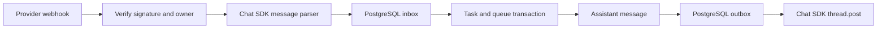

# Optional messaging channels

Sidekick works without a messaging provider. Telegram and WhatsApp Business Cloud are optional channels bound to one owner's private conversation. Default local mode has one owner; hosted mode authenticates users with Google and gives each an immutable UUID, private runtime and database schema. Channels do not create Sidekick accounts or accept arbitrary bot users. They use Vercel Chat SDK 4.41.0: `chat`, `@chat-adapter/telegram`, `@chat-adapter/whatsapp`, and `@chat-adapter/state-pg`.

The implementation uses the official adapters to normalize inbound messages and send replies. Sidekick verifies the raw webhook before it saves an inbox row. It then creates the task and queue job in the same PostgreSQL transaction as the inbox mapping. This avoids an acceptance gap between SDK webhook deduplication and task persistence. The adapters' direct webhook dispatchers are not used. [Chat SDK adapters](https://chat-sdk.dev/docs/platform-adapters), [PostgreSQL adapter source](https://github.com/vercel/chat/tree/main/packages/state-pg).



## Secure setup and saved settings

Open **Channels** in Sidekick. Setup forms send credentials directly to the trusted server, outside the conversation and model. Hosted requests pass through the signed-in account's gateway and fixed-owner runtime. The server verifies the selected provider account and stores the settings encrypted with AES-256-GCM in PostgreSQL. Local mode uses the same injected Keychain or environment key store as the Vault. Hosted mode receives its own environment/user-derived Vault key; the gateway master key stays outside the actor. Both modes bind ciphertext to owner and channel. Status endpoints return account labels and setup state, never tokens or webhook secrets.

Hosted setup claims the verified bot or business account ID for one Sidekick user before activation. Another user cannot claim that account in the same deployment. The claim/release operation uses a signed internal request and checks the active runtime lease. User-supplied owner IDs and webhook paths cannot select another tenant. Users enter their own bot/business credentials; they do not need the operator's model, Composio or computer-provider keys.

Each saved channel exposes **Remove channel** directly, with one confirmation. An accepted removal returns focus to Connect. **Finish setup** opens the saved delivery instructions in a dialog when webhook setup is incomplete; Escape or Close returns to that action. The list does not offer a replacement setup menu.

The saved settings override legacy environment settings for that provider on startup. Hosted actors do not inherit operator-level Telegram/WhatsApp credentials. Removal disables the channel, removes its stored ciphertext and releases its hosted account claim; it does not revoke the provider token or delete an existing remote webhook. Transport replacement waits for an active delivery before installing the new owner binding. Failed account verification does not replace the current settings. Telegram registration intent is persisted before calling the provider and can recover after restart. A provider setup request and a database commit are separate systems; after an uncertain registration error, inspect provider state before retrying or moving the bot.

`src/server/channel-settings.ts` owns storage and routes. `src/ports/channel-settings.ts` defines verification and account claims, `src/providers/chat-sdk/settings.ts` calls provider APIs, and composition injects the verifier and transport factory. `server/hosted-webhooks.ts` routes authenticated provider ingress to the correct runtime. The settings service does not expose a raw environment editor.

## Telegram setup

Create a bot with [BotFather](https://t.me/BotFather). In Channels, enter its token and your numeric Telegram user ID. The server checks `getMe` before saving. The numeric ID is still required in both local and hosted modes; a username or phone number is not accepted. Successful setup shows **Start conversation**, using only the verified bot handle. It clears the token fields and focuses this next action. Open the bot, press Start if prompted, and send a short message. The saved account keeps the same link. No popup or initial message is sent automatically. The link does not contain a one-time pairing challenge, and the app has no verified test-message challenge; those remain proposed flows. `getMe` verifies the bot token, not the human identity of the manually entered sender. See [Telegram bot commands and deep links](https://core.telegram.org/bots/features#deep-linking).

Local single-owner mode polls when no webhook URL is supplied, so no tunnel is needed. Hosted mode always uses the server-generated HTTPS callback `https://<configured-origin>/api/webhooks/telegram/<opaque-token>`. The opaque token is 43 URL-safe characters derived by the gateway from environment, owner and provider; do not invent it or remove the final path segment. It routes the callback, while the independently generated Telegram secret authenticates it. The hosted verifier accepts only its exact configured callback, regardless of a client-supplied URL. Registration saves only `message` updates and leaves pending provider updates intact.

Local polling uses `getUpdates` every two seconds while the app runs, with a bounded request timeout. Each accepted message reaches the durable inbox before its offset advances in PostgreSQL. A failed inbox write leaves the update eligible for retry; duplicate updates cannot create duplicate tasks. Parsing and sending still use the official Chat SDK adapter. Sidekick does not start the SDK's automatic polling dispatcher, which would bypass the durable inbox.

If the bot already has a webhook, local polling setup is rejected. Sidekick never deletes an existing webhook automatically. In local single-owner mode, you can instead enter a public HTTPS URL ending in `/api/webhooks/telegram`; saving registers that exact URL with a generated secret. Hosted setup uses the opaque route above. Webhook registration can replace that bot's previous destination, so use a separate development bot and token for local tests, never a production token. The local forwarder must expose only webhook routes. [Telegram Bot API](https://core.telegram.org/bots/api#getupdates), [webhook setup](https://core.telegram.org/bots/api#setwebhook).

Legacy environment configuration remains supported for the single-owner local app:

```dotenv
TELEGRAM_ENABLED=true
TELEGRAM_BOT_TOKEN=
TELEGRAM_WEBHOOK_SECRET_TOKEN=
TELEGRAM_ALLOWED_USER_ID=
TELEGRAM_MODE=polling
```

Omit `TELEGRAM_MODE` for the existing webhook mode. The webhook secret must have 16–256 characters from letters, digits, `_`, and `-`. Configure the same secret through `setWebhook` when managing a webhook outside the form.

The configured sender ID and private chat ID must both match the allowed Telegram user. Groups, channels, edits, callbacks, other senders, and messages without text do not start tasks. Voice and inbound uploads are not implemented. Passwords use private web forms; a pending verification code can be accepted in its originating owned channel and intercepted before ordinary message persistence. Action confirmations accept yes/no text in that same channel. Telegram can deliver owned task artifact bytes after the server rechecks their owner and task; partial or uncertain sends are not replayed automatically. [Chat SDK Telegram adapter](https://chat-sdk.dev/adapters/official/telegram).

## WhatsApp setup and eligibility

The Channels form accepts the business access token, app secret, business phone number ID, your allowed number, and a verification token you choose. It checks the selected business phone through the Graph API before saving. Register the exact callback shown in saved setup and the verification token in Meta, and subscribe to `messages`; the UI reports that this manual setup is still required. Local single-owner callbacks end in `/api/webhooks/whatsapp`; hosted callbacks end in `/api/webhooks/whatsapp/<opaque-token>`. Keep the whole hosted path. Saving credentials does not verify message delivery.

Use the official WhatsApp Business Cloud API, not personal-account QR automation. Before enabling it, check the current WhatsApp Business terms, AI-provider eligibility for the relevant market, account requirements, and charges. The flag below records that operator decision. It is not an eligibility check, approval from Meta, or permission to operate a general assistant worldwide. A transport SDK cannot bypass platform policy. [WhatsApp Business terms](https://www.whatsapp.com/legal/business-solution-terms), [Meta WhatsApp documentation](https://developers.facebook.com/documentation/business-messaging/whatsapp/overview).

Legacy single-owner environment configuration uses:

```dotenv
WHATSAPP_ENABLED=true
WHATSAPP_POLICY_CONFIRMED=true
WHATSAPP_ACCESS_TOKEN=
WHATSAPP_APP_SECRET=
WHATSAPP_PHONE_NUMBER_ID=
WHATSAPP_VERIFY_TOKEN=
WHATSAPP_ALLOWED_NUMBER=
```

The allowed number contains 7–15 international digits without `+`. The phone number ID is Meta's business sender ID. These are different identifiers. Use an appropriate system-user access token for continued use. Sidekick verifies GET challenges and the raw POST body's `X-Hub-Signature-256` HMAC. It also requires the expected business phone ID and exact allowed number. The opaque hosted route does not replace those checks. Phone-hidden or BSUID-only users are not supported by this per-owner binding. Use separate development credentials, numbers and callbacks; never move a production business callback to the local relay for a test. [Official Chat SDK WhatsApp adapter](https://chat-sdk.dev/adapters/official/whatsapp).

WhatsApp replies are free-form text only. Sidekick blocks a send if the latest accepted owner message is at least 24 hours old. It does not send templates, proactive campaigns, or delayed replies outside that window. A blocked reply remains in the web app, and artifacts use the web-app attachment fallback. WhatsApp delivery receipts and channel audio/media are not implemented. Check current provider prices before live use; SDK installation is not a messaging-cost quote.

## Reachability and local hosted testing

The selected runtime and PostgreSQL must be available: an awake host in local mode, or the hosted gateway and tenant processes. Telegram local polling needs outbound access only. Webhooks require the provider to reach the exact HTTPS callback. Keep unauthenticated single-owner mode private. Hosted mode has Google sessions and tenant isolation, but a local test tunnel should still expose only the dedicated webhook relay.

Use [hosted development](development.md#hosted-mode-on-your-computer) to run the gateway at `http://localhost:4330` with development-only database, keys, provider accounts and bots. Start these commands in separate terminals:

```sh
node scripts/webhook-relay.mjs
cloudflared tunnel --url http://127.0.0.1:4331
```

Set `SIDEKICK_WEBHOOK_ORIGIN` in the private `.env.hosted.local` to the tunnel's HTTPS origin and restart the gateway before channel setup. The server then generates the opaque per-owner callback using that origin. The relay listens on `127.0.0.1:4331` and forwards permitted requests to `http://localhost:4330`: Composio POST, Telegram/WhatsApp POST with the exact opaque path, and WhatsApp GET verification. It preserves raw bytes and signature headers, strips cookies and caller identity headers, and rejects all other routes. Login and app-consent callbacks remain on localhost:4330. It does not expose account settings, chat, files, computer access or internal control.

A tunnel URL alone does not register a provider callback. Telegram setup registers the server-generated route; WhatsApp requires the displayed callback in Meta. When the tunnel origin changes, update the development environment and re-register only development callbacks. Production uses the configured public HTTPS application origin without this local relay. Provider secrets, the original signature, the allowed sender and account identity are checked independently of the route token.

Credential and approval links are replaced in outbound replies with an instruction to open Sidekick securely. Password forms remain in the authenticated web app; owned yes/no action confirmations and pending verification-code replies have dedicated channel handling. Messages use a conversation identity bound to provider, business/bot account and allowed sender. A short answer can continue that conversation's waiting task; it cannot resume another channel's task. Schedules and unrelated web tasks have no channel mapping and do not send messages to the owner automatically.

## Persistence and recovery

`channel_inbox` retains a unique provider/account/message identity, normalized text, sender, destination, provider timestamp, task ID, and acceptance state. Creating a task, creating its queue job, and recording its mapping use one transaction. A database or queue failure leaves the inbox pending for retry. Duplicated webhooks do not create another task.

An event listener and a two-second fallback scan find assistant messages for mapped tasks. `channel_outbox` records one delivery per assistant message. Access is checked again before sending. Changing the sender binding or disabling the channel blocks old pending deliveries. Channel tables and Chat SDK state use PostgreSQL, inside that tenant's private schema in hosted mode. Message content is not covered by Vault encryption or automatically deleted. Messaging providers also process messages under their own policies.

The outbox records `sending` before the provider request. A provider acceptance becomes `sent`; this means the API accepted the message, not that the owner received it. A failed or interrupted send becomes `uncertain`. It is not automatically retried because the provider may already have accepted it. On restart, leftover `sending` rows become `uncertain`. Inspect the owned conversation and provider before deciding whether to send again. There is no exactly-once guarantee for an external send, no automatic backoff/retry for rate limits, and no operator resend UI yet.

`GET /api/channels` is an owner-scoped status endpoint behind Google authentication in hosted mode. `disabled`, `setup_required`, and `configured` describe transport setup. A configured transport does not establish current token validity, webhook registration, policy eligibility or recipient delivery. Saved channel setup separately reports registration status. SDK logging is silent to keep tokens and message payloads out of logs. Run one local owner process, or use the hosted runtime manager's leased generation per UUID; do not launch duplicate actors or clear an uncertain lease to force delivery.

## Validation

For an authorized live test, use a separate development bot/account and a synthetic marker such as `Sidekick development test 2026-09-26 <run-id>`. Send the marker from the configured human account, observe one accepted inbox message, then confirm the matching reply in that account. Record registration, provider API acceptance and observed recipient delivery separately. Verify a duplicate callback does not create another task and an unrelated sender is rejected, using only accounts controlled for the test. Use a synthetic file for Telegram artifact delivery. Do not put tokens, webhook secrets, authorization URLs or private conversation content in reports or logs. Production acceptance repeats the checks against production configuration; a local test does not prove it.

The 2026-09-26 live development Neon preflight verified two restricted tenant roles/private app/jobs schemas, pg-boss dispatch, private object-store initialization and denied foreign/control access in a temporary database, then removed its resources. It did not verify Telegram/WhatsApp account setup, registration, pairing or delivery. One-time Telegram pairing remains unimplemented.

`tests/channels.test.ts` uses the real SDK adapters and an isolated PostgreSQL schema. Every provider request is mocked. It covers invalid secrets/signatures, owner/group/business rejection, task-transaction rollback, duplicate events, destination routing, unrelated web replies, secure-link replacement, closed WhatsApp windows, uncertain sends, restart recovery, and changed owner bindings.

```sh
npx tsx --test tests/channels.test.ts
```

Supply `TEST_DATABASE_URL` privately for a disposable development database; without it, the database fixture is skipped. Never point fixtures at the production database. `tests/channel-settings.test.ts` and `tests/channel-application.test.ts` also cover encrypted settings, verification failures, ciphertext binding, secret-free responses, polling offset recovery, transport replacement, and channel-specific continuation. Hosted webhook, account-registry and lease fixtures cover UUID routing, exact opaque paths, exclusive account claims and stale-runtime rejection. `tests/channels-ui.test.ts` and `tests/channel-status-ui.test.ts` cover direct removal and cancellation, stale status responses, focus return, delivery guidance, and the verified Telegram conversation link. These UI checks do not open Telegram or send a message. No provider account, webhook registration, recipient delivery, or Meta approval was tested live by these fixtures.
