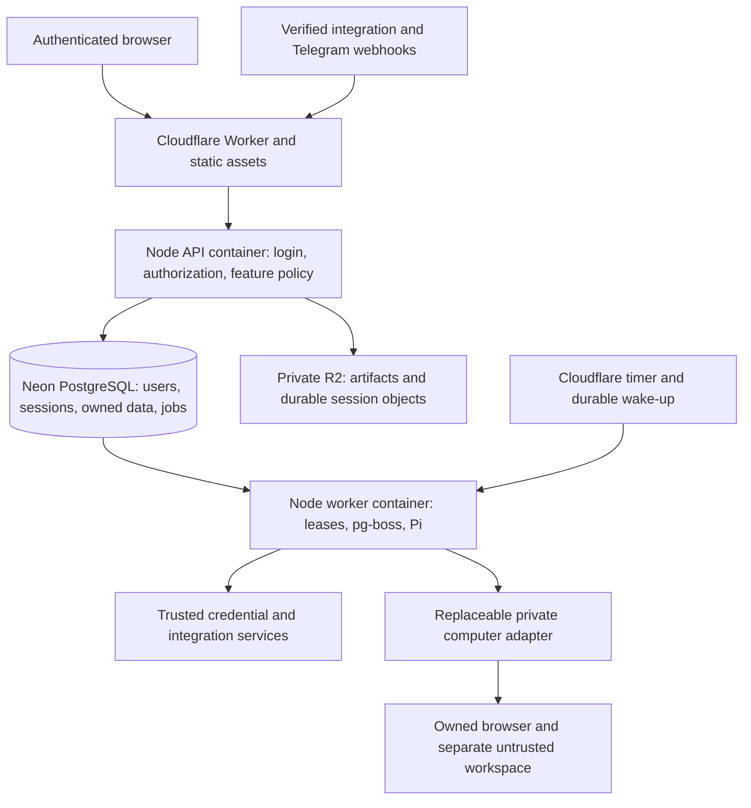

# Cloud hosting, authentication and tenant isolation

Research date: 2026-09-26. Repository inspected at `1a471a0`. This is a proposed design, not an implemented deployment or a live-provider validation. No account access, account plans, domains, credentials, production data, or paid resources were inspected or changed. Published prices below are USD because that is how the providers quote them; they are not a Sidekick budget or a verified account quote.

## Recommendation

Keep React/Vite, Fastify, Pi and PostgreSQL. Deploy a small Cloudflare Worker for the public origin and asset delivery, with the trusted Node application running in Cloudflare Containers on Jan's account. Use Neon PostgreSQL in a nearby EU region, private R2 storage, and Better Auth with Google sign-in. Keep computer execution behind the existing capability interfaces and select its provider separately from application hosting.

This is the best fit for the current code and the requirement to let other people host Sidekick. It preserves a normal Node container that can also run on another host. Cloudflare-specific ingress and lifecycle code stay in one deployment adapter. The application must become tenant-aware before it is publicly exposed.

The recommendation is conditional on a short real-platform feasibility exercise after prototype review: image startup, Pi transcript persistence, long streaming requests, worker wake-up/recovery, private computer control, and database latency. If a Cloudflare constraint fails that exercise, keep the frontend/ingress on Cloudflare and run the same Node image on a conventional container host. Do not silently replace the runtime or weaken isolation to force a Worker-only deployment.

The diagram describes logical boundaries. API and worker use the same versioned image with separate process roles; start with one instance of each. Replicas require the lease/recovery changes below. The computer must not receive database, OAuth, Composio, model, or vault master keys.

## What the repository actually does today

| Surface            | Current evidence                                                                                                                                           | Required change                                                                                                         |
| ------------------ | ---------------------------------------------------------------------------------------------------------------------------------------------------------- | ----------------------------------------------------------------------------------------------------------------------- |
| Identity           | `src/server/config.ts:5` exports `ownerId = 'local-development'`; `app.ts`, `tasks.ts` and composition-bound services reuse it                             | Canonical app user ID from a verified session or an owned durable job; no global current user                           |
| HTTP               | `src/server/index.ts` listens on `127.0.0.1`; `src/server/access.ts` enforces localhost/origin policy                                                      | Explicit local and hosted modes, HTTPS origin allowlist, authenticated routes, CSRF controls and trusted proxy handling |
| Live chat          | `src/server/events.ts` emits global events without owner identity; `/api/events` in `src/server/app.ts:243` forwards every event to every subscriber       | Owner-scoped event transport and session-aware stream lifecycle; otherwise live text leaks even if SQL reads are fixed  |
| Database           | Startup DDL lives in `db.ts` and feature initializers; there are no RLS policies in the inspected server code                                              | Versioned migrations, restricted runtime roles, tenant policies and same-owner foreign keys                             |
| Indirect ownership | `task_events` has only `task_id`; channel inbox/outbox lack `owner_id`; `notifications.event_id` and integration event IDs are global                      | Explicit ownership or policy through an owned parent; environment/provider/account-scoped dedupe                        |
| Worker recovery    | `startTaskWorkers` changes all running tasks for the global owner into recovery waits; channel initialization changes all sending outbox rows to uncertain | Worker instance IDs, expiring leases, fencing and recovery of expired work only                                         |
| Queue              | `pg-boss` runs in the app process; task polling is every 0.5 seconds with four local workers                                                               | Separate process roles, bounded concurrency per user, durable wake-up and queue monitoring                              |
| Files              | `.local/` contains artifacts, workspaces and Pi session files; Pi uses `SessionManager.continueRecent`                                                     | Durable private storage ports, owned namespace and crash-safe checkpoint/replay rules                                   |
| Computer           | Docker workspace and separate trusted browser selected in `composition.ts`; current shell resources are single-owner                                       | Remote provider adapters and real tenant isolation, preserving the browser/credential boundary                          |
| Encryption         | Vault and channel ciphertext include the owner in authenticated encryption binding                                                                         | Explicit migration and key rotation; changing an owner column alone breaks decryption                                   |
| UI preferences     | Appearance is stored under a global `sidekick.theme` localStorage key                                                                                      | Persist owned settings; clear user content and partition local caches on sign-out/account change                        |
| Delivery           | `.github/workflows/ci.yml` already runs checks, PostgreSQL fixtures, build and secret scans                                                                | Add image/migration/deployment jobs after these gates; there is no production CD today                                  |

The existing ownership checks, account-bound approvals, raw webhook verification, task revisions, cancellation, secure credential forms and separation of browser/shell should be retained. They are useful foundations, but the current single-owner assumptions are not a multi-user security boundary. See the current [production requirements](../production.md), [architecture](../architecture.md) and [security guide](../security.md).

## Cloudflare: where each workload belongs

| Option                      | Fit                                                                                                                                                                             | Decision                                                                                                                                                                                                                                          |
| --------------------------- | ------------------------------------------------------------------------------------------------------------------------------------------------------------------------------- | ------------------------------------------------------------------------------------------------------------------------------------------------------------------------------------------------------------------------------------------------- |
| Workers only                | Good for ingress/assets and bounded HTTP services. Current Node compatibility still exposes `node:child_process` as a nonfunctional stub; importing it is not execution support | Do not port the whole app as part of login/hosting. Existing Docker bridges, local files and long-lived job polling need replacement or a different runtime. [Node compatibility](https://developers.cloudflare.com/workers/runtime-apis/nodejs/) |
| Worker + Containers         | Runs normal Linux images and supports a full filesystem/runtime. Containers require Workers Paid                                                                                | Recommended application host, subject to the feasibility gates. [Containers overview](https://developers.cloudflare.com/containers/)                                                                                                              |
| Worker + external Node host | Same public origin and ordinary container deployment elsewhere                                                                                                                  | Fallback and documented self-hosting option. Product code should not depend on Cloudflare lifecycle types                                                                                                                                         |

Cloudflare container disk is ephemeral across sleep/restart. Instances have no guaranteed uninterrupted lifetime, and shutdown uses SIGTERM followed by a later forced stop. Built-in stateless autoscaling is not available in the current FAQ. A process being alive is not a durable scheduling guarantee. Use object/database persistence and control instance counts explicitly. Do not use Docker-in-Docker to move the existing shared local environment into the trusted application container. [Container FAQ](https://developers.cloudflare.com/containers/faq/)

Regional and EU jurisdiction constraints are now documented for Containers. Configure an EU placement boundary when provisioning, align the database region, and measure the actual path. This does not establish the residency of every other provider, log, backup or connected integration. [Placement](https://developers.cloudflare.com/containers/concepts/placement/)

Worker streams can pass the API's SSE response through without buffering the whole body. Container `fetch` also forwards WebSocket upgrades. Keep SSE for chat initially, and test heartbeat, disconnect, reconnect, proxy buffering and deployments on the real platform. Browser takeover must authenticate and authorize its own connection; an unguessable viewer URL alone is insufficient. [Streams](https://developers.cloudflare.com/workers/runtime-apis/streams/), [Container WebSockets](https://developers.cloudflare.com/containers/examples/websocket/)

### Events between API and worker processes

**Proposed engineering design, subject to local and live feasibility tests:** use a PostgreSQL event outbox and per-owner feed for the first hosted version. The existing process-local `EventEmitter` cannot deliver worker updates to a separate API process. A separate authenticated pub/sub service is a later transport option if measured fan-out or database load warrants it; it would not replace durable state or owner checks.

- A feature transaction writes its state change and a typed feed event with `owner_id`, task identity where applicable, task revision and a per-owner cursor. Serialize cursor allocation within that owner's transaction so a later committed event cannot hide an earlier, still-uncommitted event. Never derive the owner from an SSE subscription parameter.
- Workers coalesce streaming text into bounded chunks rather than inserting every token. A 250 ms flush interval and 15-minute transient-feed retention are initial experiment settings, not measured product guarantees. Each chunk carries stream identity and sequence, and publishing verifies the current task revision and execution lease. Durable messages and action receipts remain the recovery source of truth; final state and its completion event commit together.
- API instances hold a dedicated direct database connection for `LISTEN`. Send only a generic change hint through `NOTIFY`, with no conversation text, credentials or owner metadata. Each instance then reads committed feed rows under each active session's verified owner and RLS context. PostgreSQL notifications are delivered to listening sessions after commit; the table is the durable record. [PostgreSQL NOTIFY](https://www.postgresql.org/docs/current/sql-notify.html)
- Catch up from the database on connection, listener reconnection and a bounded periodic check while subscribers exist; start by testing a five-second fallback interval. A missed notification must delay delivery rather than lose the update. SSE `Last-Event-ID` is interpreted only within the authenticated owner's feed. Clients ignore duplicate cursors and stream chunks, reject stale revisions, and reload owned canonical state when a cursor has expired.
- Check session validity throughout a stream and close it on revocation. Bound subscriber count, backlog, payload size and retention. Keep transient text private and out of logs. Test separate API/worker processes, concurrent commits, lost notifications, both process restarts, expired cursors and a second user deliberately presenting the first user's task and cursor values.

### Jobs and schedules

Keep PostgreSQL/pg-boss as the authoritative queue in the first implementation. Moving simultaneously to Cloudflare Workflows would add another state migration and weaken host portability without proving a need.

- Introduce worker IDs, task leases, renewal, graceful draining and fencing on task revision plus lease identity. A starting replica must never mark another replica's active tasks interrupted.
- Release execution capacity while waiting for user input, credentials or approvals. Existing durable waits should survive container replacement.
- Persist accepted schedule occurrences, webhook receipts and a dispatch/wake intent in one application transaction. Publish to pg-boss using an idempotent job identity and retry the dispatch until acknowledged; do not depend on an unverified cross-library transaction integration. Wake-up is a hint, and reconciliation must discover committed intents even if the hint is lost.
- Replayed jobs must not repeat uncertain external sends, approved browser actions or integration writes. Preserve the existing uncertain-outcome states and add an operator recovery path.

**Proposed initial Cloudflare lifecycle, subject to a real-platform feasibility test:**

1. Route the worker role to one named Container/Durable Object per environment, such as `worker-primary`, through a separate worker binding. The configured environment chooses the instance; a client-supplied owner, task ID or URL cannot select a container. The API role has its own binding and lifecycle.
2. Keep the worker intentionally awake while that environment's worker role is enabled. Implement its `onActivityExpired` policy explicitly rather than relying on outbound PostgreSQL polling to count as activity. Cloudflare's default idle hook stops the container; an override that does not stop it renews the timer. The class also exposes `schedule` for persisted callbacks; do not override the lifecycle's underlying `alarm()` method. These are platform mechanisms, not an availability guarantee. [Container class reference](https://developers.cloudflare.com/containers/reference/container-class/)
3. After a committed dispatch intent, the trusted API makes a best-effort call to a narrow Worker wake endpoint. Require an environment-specific server signature over method, path, timestamp, nonce and body hash; enforce a short validity window, reject reused nonces and coalesce bursts. Browser sessions are not authorized for this endpoint. Its only operation is to start/reconcile the configured worker, and it accepts no arbitrary task, owner, command or destination. The Worker routes it separately from public API forwarding and calls the worker through its binding; the worker's control port is never exposed as an unauthenticated proxy.
4. Configure a Cron Trigger every minute to address that same worker binding independently of request traffic. Start or check the container, then invoke a bounded, authenticated reconciliation operation. Worker-to-container control uses a distinct internal credential and fixed route; public ingress rejects that route. Containers can be started by a scheduled Worker handler. A one-minute cadence is a proposed recovery check, not a promised maximum scheduling delay. [Cron Container](https://developers.cloudflare.com/containers/examples/cron/)
5. Reconcile on worker startup, periodically in the running worker and on internal wake. Under database leases, publish pending dispatch intents, materialize due schedule occurrences once by their occurrence identity, and recover only expired execution leases. The internal operation scans authorized persisted work; it does not execute user-supplied commands. A successful health probe alone must not acknowledge undelivered intents.
6. Bound wake/start retries, record the last successful reconciliation and alert on stale worker heartbeat, oldest ready-job age or repeatedly failing dispatch. On shutdown, stop claiming new work, checkpoint accepted progress and drain within the available window. A forced stop is handled by lease expiry and uncertain-outcome recovery, not unconditional replay. An operator disable switch must stop both automatic wake paths before an intentional shutdown.

The pilot pays for an awake worker and its database polling. Add scale-to-zero only after delayed schedules, incoming webhooks, restart failures and expired leases can wake workers reliably without a visiting user. Keep `wake` and `reconcile` behind a deployment adapter so a self-host can use an always-running process and its own scheduler. The feasibility exercise must demonstrate this lifecycle with dropped wake hints, a stopped container, duplicate Cron invocations, database unavailability and an interrupted external action.

### Durable files and secrets

Create private `ArtifactStore` and agent-session persistence capabilities. Filesystem implementations serve local/self-hosted installations; an S3-compatible implementation serves R2 or another object store. Keep opaque object keys in the database, with owner/task metadata and bounded media reads. A task ID or a path supplied by a browser cannot choose another user's storage namespace.

Pi expects local session files today. Decide and test an explicit checkpoint design: temporary owned local cache, versioned durable session snapshots, single-writer lease and recovery pointer. Persist accepted messages/action receipts before they become eligible for replay; a checkpoint only at successful task completion is inadequate. Do not make R2 FUSE the implicit database/session filesystem without proving locking, write and crash behavior.

Prefer authenticated API streaming for sensitive files and private browser frames. If direct upload/download is needed, issue short-lived URLs only after owner/size/type checks. Presigned R2 URLs grant bearer access until expiry and use the S3 API domain rather than a custom domain. They are not equivalent to a revocable app session. [R2 presigned URLs](https://developers.cloudflare.com/r2/api/s3/presigned-urls/)

Put provider keys in environment-specific Cloudflare secrets and inject only the values needed by the trusted container. Cloudflare documents both Worker Secrets and Secrets Store as sources for container environment values. Do not place secrets in Docker build arguments, images, frontend `VITE_*` config, provider computer environments or logs. [Container secrets](https://developers.cloudflare.com/containers/examples/env-vars-and-secrets/)

The user's existing provider keys can initially fund hosted model/speech services if their account permits that usage. Copy them through secret tooling during implementation without displaying their values; record only the secret names. Prefer separate production-scoped provider keys and budgets. Use different Composio projects/keys, webhook secrets, Google OAuth projects, auth signing secrets, vault keys, bot tokens, database credentials and storage namespaces for production versus development. Encrypt user-owned bot credentials through the trusted key-store capability, with key versioning and a restore/rotation runbook.

## Database choice and costs

| Provider                             | Why it fits                                                                               | Tradeoff                                                                                                                             |
| ------------------------------------ | ----------------------------------------------------------------------------------------- | ------------------------------------------------------------------------------------------------------------------------------------ |
| Neon                                 | Standard Postgres; useful disposable branches and usage billing; works with existing `pg` | Frequent queue polling keeps compute active; choose backup/restore and access-control plan deliberately                              |
| Supabase Postgres                    | Standard Postgres with an optional broader auth/storage stack                             | A good alternative if that stack is wanted; Sidekick does not need its client data API or realtime/auth services to use its database |
| Plain managed/self-hosted PostgreSQL | Same schema and SQL portability                                                           | Operator owns patching, backups, restore, connection limits and availability according to the chosen service                         |

Neon's current Launch rate is $0.106/CU-hour and database storage $0.35/GB-month; Scale compute is $0.222/CU-hour. Paid plans have no minimum monthly fee; restore history and other usage are additional. A constantly awake 0.25 CU database for a 720-hour month is **$19.08 of Launch compute**, before storage/restore/network/tax. This is arithmetic from public rates, not a measured Sidekick size recommendation. The current 0.5-second polling loop means scale-to-zero must not be counted as an automatic saving. [Neon plans](https://neon.com/docs/introduction/plans), [Scale to zero](https://neon.com/docs/introduction/scale-to-zero)

Supabase Pro starts at $25/month, with one default Micro project covered by the included compute credit; additional projects and larger compute add cost. It bundles services that may be unnecessary with Better Auth and R2. [Supabase billing FAQ](https://supabase.com/docs/guides/platform/billing-faq)

Cloudflare's $5/month Workers Paid plan is a platform starting charge, not the total. Containers separately meter provisioned memory/disk and active CPU; requests also incur Worker/Durable Object usage. Public rates include $0.0000025/GiB-second memory, $0.000020/vCPU-second CPU and $0.00000007/GB-second disk after allowances. Add network, logs and computer-provider usage. Benchmark the API and worker separately before sizing. [Container pricing](https://developers.cloudflare.com/containers/platform/pricing/)

R2 Standard storage is $0.015/GB-month, with request charges and an included tier; Internet egress is not charged by R2. Other components may still charge transfer. [R2 pricing](https://developers.cloudflare.com/r2/pricing/)

Use the standard `pg` driver over TLS from Node Containers. A small number of bounded direct pools is the safest initial baseline for migrations and workers. Neon's pooled endpoint uses transaction pooling and does not preserve session-level state, session advisory locks or LISTEN subscriptions. Before using it, exercise pg-boss startup/migration/lease behavior and all tenant-context transactions against the installed versions. Use a direct connection for schema migrations, restore/dump and any session-bound listener. If API pooling is later enabled, tenant context must be set within each transaction on its checked-out connection. [Neon pooling](https://neon.com/docs/connect/connection-pooling)

Keep production in a separate database/project from disposable tests. Create test branches from synthetic baselines rather than cloning private production conversations, OAuth tokens or Vault contents. A schema name alone is not the desired credential boundary between development and production.

## Google login and portable authentication

Recommend **Better Auth backed by Sidekick's PostgreSQL**, with Google as the initial social provider. Its official docs cover Fastify and direct `pg.Pool` support. It fits the existing stack and leaves identities/sessions with the self-hosting operator. Pin the selected version and exercise the real callback/cookie flow before adopting it. [Fastify integration](https://better-auth.com/docs/integrations/fastify), [PostgreSQL adapter](https://better-auth.com/docs/adapters/postgresql)

Clerk is a credible hosted alternative with managed UI and operations, but adds a mandatory identity service for each hosted installation; production Google credentials are still required. Supabase Auth is another option if the broader Supabase stack is selected. These are replacement decisions, not additional services to install alongside Better Auth. [Clerk Google setup](https://clerk.com/docs/guides/configure/auth-strategies/social-connections/google), [Supabase Google setup](https://supabase.com/docs/guides/auth/social-login/auth-google)

### Provider setup

1. Create separate development and production Google Cloud OAuth projects. Production must not reuse the development project's localhost/test redirects. Configure the app's audience as external for personal Google accounts; an n8n-only internal app would not meet the requested outcome.
2. Configure branding, support contacts, owned domains, a public home page, privacy information and the applicable publication/verification steps. Production Gmail/Calendar permissions need a separate scope review from basic sign-in. Google requires separate test/production projects and review of sensitive/restricted scopes. [Google production policy](https://developers.google.com/identity/protocols/oauth2/production-readiness/policy-compliance)
3. Create a Web application OAuth client. For development, register `http://localhost:4310/api/auth/callback/google`. Production gets `https://<chosen-host>/api/auth/callback/google`; staging uses a separate client/project configuration. These are intended callback shapes, not provisioned URLs.
4. Store `GOOGLE_CLIENT_ID`, `GOOGLE_CLIENT_SECRET`, the auth session secret and a fixed public auth base URL only in the corresponding server environment. Configure exact trusted origins and allowed post-login destinations. Better Auth's callback follows `/api/auth/callback/google`; a correct explicit base URL avoids proxy-derived callback errors. [Better Auth Google](https://better-auth.com/docs/authentication/google)
5. Request only `openid email profile` for app login. Gmail/Calendar connection remains a separate Apps flow through Composio, with distinct account selection and consent. A user may sign in with one Google identity and connect a different or additional account.
6. Give each user an internal immutable ID. Link Google by the verified issuer/provider subject, not by email. Google's `sub` is stable; email can change and is not the primary identity key. Validate claims using the library's server-side OAuth flow. [Google OpenID Connect](https://developers.google.com/identity/openid-connect/openid-connect)

Use database-backed sessions with `HttpOnly`, `Secure` production cookies, appropriate SameSite settings, origin/CSRF checks, bounded expiry and session revocation. Keep auth routes and application routes protected separately: installing the auth handler does not automatically authorize Sidekick APIs. Better Auth documents state/PKCE, cookies and trusted-origin protection. Configure known proxy headers at the ingress and never trust a caller's arbitrary forwarded host. [Better Auth security](https://better-auth.com/docs/reference/security)

Disable cookie session caching initially so revocation is checked against the session store. If caching is introduced later, account for its documented revocation delay and bypass it for sensitive operations. Close SSE/control connections after session expiry or revocation; clear web state, blob URLs, cached responses and private frames on sign-out. Signing out need not cancel the user's explicitly enabled background work, but must stop that browser's access. [Session management](https://better-auth.com/docs/concepts/session-management)

## Tenant isolation: implementation contract

Authentication determines who is calling. Every feature must then authorize what they can access. The following is the proposed contract, not proof that current code enforces it.

### Request, job and provider context

- Construct an immutable context containing canonical user ID, environment and authorized session/job identity. Pass it through factories and calls; remove imports of the global owner from feature logic.
- Browser requests cannot choose their owner ID. Jobs carry owner/task/revision/lease identifiers and reload the owned task before execution. Webhooks resolve ownership from the registered provider connection or paired bot, never email/sender claims in arbitrary event text.
- Keep all provider handles in server-owned records: Composio entity/session, connection ID, trigger ID, bot identity, browser profile, computer instance, lease, artifacts and transcripts. Guessing a handle must not grant access.
- Auth identity/profile fields and assistant personal context are separate concepts. Changing a display name does not relink a Google account. Connecting Gmail does not change app ownership.

### Database protection

Use application authorization plus RLS as defense in depth. The runtime data role must not be superuser, table owner or `BYPASSRLS`; migrations use a separate credential. PostgreSQL table owners normally bypass RLS, and `FORCE ROW LEVEL SECURITY` can apply policies to them. RLS policies need both read/use and write/check expressions. [PostgreSQL row security](https://www.postgresql.org/docs/current/ddl-rowsecurity.html)

Set the current user with transaction-local state on the same checked-out database connection as every owned query; absent context fails closed. Never set a pool-wide/session-global tenant value and return the connection to another request. Auth storage, job claims and migration administration need narrowly scoped roles/entry points rather than disabling policies for the whole app. Test using the real runtime role, not only the schema owner.

Add same-owner composite references for relationships such as message/task, artifact/task, approval/task, source message/task, schedule/run and connection/subscription. Add ownership to channel inbox/outbox and task events, or enforce an explicit parent policy everywhere; prefer explicit ownership for operational tables. Review all global uniqueness constraints and dedupe keys for environment/provider/account collisions. A UUID is an identifier, not an authorization check.

### Full audit surface

| Boundary         | Must be scoped and tested                                                                                                                  |
| ---------------- | ------------------------------------------------------------------------------------------------------------------------------------------ |
| Conversation     | State/history/search, archived generations, reactions, quoted replies, outcomes, pending input, reset/onboarding and streaming deltas      |
| Work             | Task reads/cancel/resume, schedules/run history, event triage, preferences, goals, memory facts and profile                                |
| Apps             | Consent attempts/callback state, account listing, tools, downloads, approvals, subscriptions, incoming events, reconnect and disconnect    |
| Channels         | Bot token storage, pairing, webhook secret, provider account/sender mapping, inbox/outbox/media, uncertain delivery and disconnect cleanup |
| Files            | Upload association, artifact bytes, media/range requests, transcripts, export/deletion, temporary and signed URLs                          |
| Private controls | Vault list/detail/reveal/edit/delete, credential requests and OTP, browser status/screenshots, control leases and live input               |
| Runtime          | Sandbox allocation, file mounts, browser profiles, cancellation, model context, per-user budgets and concurrency                           |
| Diagnostics      | Inspector, prompt snapshots, usage, operator tools, health/readiness, logs and error messages                                              |

Keep the hosted Inspector disabled for ordinary users. If a support/admin surface is introduced, give it its own authorization and audit design; never infer admin status from a Google email alone or from the existing dev flag.

At the network layer, keep untrusted shell traffic away from the application control plane, metadata services, loopback/private/link-local destinations and credentials. Revalidate redirects/DNS/IP families for server fetchers such as link previews and downloads. Any provider that cannot enforce the required isolation/egress controls fails the production gate. Separate tenant browser profiles and trusted credential injection from shell files/processes; authenticated browser cookies are secrets too.

### Existing local data

Start new hosted users empty. Never assign all `local-development` data to the first person who signs in. If an explicit local-owner import is later requested, require a verified target identity, snapshot/restore test, ownership mapping, provider reconnection where necessary, and decryption/re-encryption under the new owner/key binding. Audit row counts and artifacts before/after. Existing ciphertext, bot bindings and external account IDs cannot be migrated safely with a blanket SQL owner update.

## Environments, domains and CI/CD

Use explicit local, development/staging and production configuration. The provider implementation choices stay in `src/server/composition.ts`; document environment variables for auth mode, storage, computer provider, model provider/model, integration provider/available apps and public URLs. Ordinary hosted users provide account consent and their own Telegram bot token, not shared service keys. Self-hosting operators supply their own service configuration.

Wrangler environments create separate Workers, and bindings/variables must be configured per environment. Define separate Durable Object namespaces, R2 buckets, secrets, database credentials, callback URLs and provider projects. Do not rely on inheritance for isolation. [Wrangler environments](https://developers.cloudflare.com/workers/wrangler/environments/)

Choose a domain in Jan's Cloudflare account before provisioning production OAuth. Worker Custom Domains manage DNS/certificates for the selected hostname. Verify the exact account ID, accessible zone, plan, limits and deployment token scopes; none is confirmed here. The public origin should serve login and app APIs together to simplify cookies and CORS. [Custom Domains](https://developers.cloudflare.com/workers/configuration/routing/custom-domains/)

Proposed pipeline:

1. Pull requests retain current locked install, type/boundary/format checks, database fixtures, client build and secret scanning. Add auth/isolation, provider-contract, migration and container smoke checks with synthetic data and no production secrets.
2. Build the immutable server image and client assets for the exact tested commit. Record image digest and schema compatibility range. Scan the resulting bundle/image for accidental secrets.
3. On successful merge to `main`, a serialized production job uses a repository environment and a narrowly scoped Cloudflare token for Jan's account. Cloudflare's official GitHub Actions approach runs `wrangler deploy` with account ID/API token held in CI secrets. Pin action revisions as the existing workflow does. [Cloudflare GitHub Actions](https://developers.cloudflare.com/workers/ci-cd/external-cicd/github-actions/)
4. Run versioned expand-only migrations under a database migration lock before deploying code that requires them. Verify backup/restore readiness; a successful dump is not a restore drill. Do not run privileged migrations from every web replica's startup.
5. Deploy the Worker/container configuration and wait for actual rollout completion. Cloudflare activates the Worker before later image/rollout steps, so deployment is not transactional and successful CLI exit is not proof every container has updated. Keep adjacent versions compatible; stop claiming new jobs, drain/checkpoint and fence replaced workers. [Container rollouts](https://developers.cloudflare.com/containers/configuration/rollouts/)
6. Check the deployed commit/image, readiness, auth callback, tenant-isolation smoke scenario, SSE reconnection and worker wake-up. Run separately authorized live-account acceptance against production. Keep health responses minimal.
7. Roll back to the retained image and compatible Worker if smoke checks fail. Do not automatically reverse destructive database changes. Use a later contract migration only after the rollback window and old workers have drained; document forward repair for incompatible schema changes.

Container previews require care: the current Container FAQ says ordinary preview URLs are not generated for Container Workers and `wrangler versions upload` does not update images. Use an explicitly provisioned staging environment or disposable named deployment, with its own provider configuration; do not label a code-only preview a full-system test. [Container deployment FAQ](https://developers.cloudflare.com/containers/faq/)

## Local testing with real providers

Local development must exercise the same ports and security behavior. Cloudflare supports running the Worker and Containers together through Wrangler with a local Docker engine; local success does not establish cloud placement or rollout behavior. [Local Containers development](https://developers.cloudflare.com/containers/guides/local-dev/)

| Mode                                  | Components                                                                                                                                 | What it establishes                                                                                        |
| ------------------------------------- | ------------------------------------------------------------------------------------------------------------------------------------------ | ---------------------------------------------------------------------------------------------------------- |
| Fast local fixtures                   | Local Postgres disposable schemas, fake identity/provider adapters                                                                         | Deterministic authorization, races, bad signatures, retries, migration compatibility and failure states    |
| Local app + live development services | Real Google development OAuth, development Composio, separate test bot, chosen remote computer, local Postgres or a disposable Neon branch | Real consent, tools, computer control and account routing without a production deployment                  |
| Local Cloudflare parity               | Wrangler + application/worker images, local storage emulator, real development providers as selected                                       | Image startup, proxy headers, routes, raw-body forwarding, SSE and shutdown behavior                       |
| Staging cloud                         | Separate Cloudflare/Neon/R2/provider environment with synthetic data                                                                       | Real cold starts, network latency, durable wake-up, restarts, rollout/migrations and callback reachability |
| Production acceptance                 | Final domain and production providers, authorized personal Google account and test bot                                                     | Live hosted journey and persistence under production configuration                                         |

For live inbound webhooks to a laptop, expose only a dedicated development ingress relay with strict routes and signature verification; forward bounded authenticated events locally. Never tunnel the currently unauthenticated full app. Local Telegram polling is another development mode, with a different bot token from production. Do not switch the production bot's transport while testing locally.

Keep all normal CI checks credential-free. A separate manually triggered/scheduled live-provider suite uses dedicated accounts, budgets and disposable records. Label each result as fixture, local UI, live development provider, staging infrastructure or live production; do not collapse them into “end-to-end passed.”

## Acceptance and implementation order

| Phase                   | Completion gate                                                                                                                                       |
| ----------------------- | ----------------------------------------------------------------------------------------------------------------------------------------------------- |
| 0. Review               | Interactive login/sidebar/profile/settings/Apps/Telegram/computer UX reviewed before production feature edits                                         |
| 1. Feasibility          | Real Node image on Cloudflare proves SSE, shutdown, durable Pi session recovery, worker wake-up and DB connectivity; no public beta users             |
| 2. Isolation foundation | Remove global owner, add authenticated context and migrations/RLS, fence jobs and streams; two-user adversarial fixture suite passes                  |
| 3. Portable providers   | Durable artifacts/sessions, hosted keys, remote computer adapters, live local development-provider suite and replaceability contract pass             |
| 4. Product flows        | Google signup/signin/signout/session expiry; owned profile/settings; account consent/watch states; secure Telegram pairing/test/disconnect            |
| 5. Delivery             | Staging and production environments, main-merge CD, migration/rollback drill, retention/deletion, bounded operator recovery and cost metrics          |
| 6. Production proof     | Authorized live account completes the journey; data persists across image restart; remote events and Telegram round trips are correlated and verified |

Production proof includes a fresh Google signup, refresh/sign-out/sign-in, owned settings persisted on a second browser, connected Gmail and Calendar, verified event arrival and processing, assistant tasks on the remote computer, artifact read, private takeover, Telegram pairing and bidirectional message/media where supported, schedule execution with the browser closed, disconnect/revoke behavior, and process replacement during work. Use disposable emails/events/files and keep private contents out of evidence files.

Isolation acceptance uses two distinct users and attempts cross-user access across every row in the audit table, including simultaneous SSE, guessed IDs, stale control leases, swapped upload IDs, provider callbacks, channel routing and background jobs. Also test anonymous access, expired/revoked sessions, foreign origins, reconnects, storage URLs and credential reveals. One successful personal Google login proves a live login only; it does not prove isolation. A second live identity test remains pending until an authorized second account is available.

## Required documentation updates during implementation

- `README.md`: hosted versus local setup, supported modes, actual commands, prerequisites and provider/account requirements.
- `docs/system-guide.md` and `docs/architecture.md`: account model, trust boundaries, durable job/storage flows, deployment topology, evidence status and cost model.
- `docs/production.md` and `docs/security.md`: readiness gates, tenant/RLS contract, key rotation, recovery, data retention/deletion, egress and abuse limits.
- `docs/development.md` and `docs/verification.md`: local provider profiles, callback relay, fixtures versus live suites, reproducible evidence and production acceptance.
- `docs/api-contract.md`: auth/session behavior, 401/403/404 conventions, owned profile/settings routes, SSE authorization, webhook ingress and control leases.
- `docs/replacing-modules.md`: auth, storage, computer, model, integration and scheduler contracts, capability negotiation and state/credential migration limits.
- `docs/composio.md`, `docs/channels.md`, `docs/vault.md`: environment separation, consent/watch/pairing lifecycle, revocation, secret provisioning and recovery.
- Area `AGENTS.md` files and configuration examples: new entry points, ownership responsibilities and exact validation commands; examples contain names/placeholders only.

Implementation is gated on prototype review and on access facts that research cannot establish: Jan's Cloudflare account/zone/plan, final hostname, deploy permissions for this repository, Google OAuth project/brand status, Neon account/region/restore plan, available provider keys and their allowed usage, Composio production permissions, remote-computer capabilities and cost limits. These are explicit unknowns, not reasons to replace live integrations with simulated production behavior.
